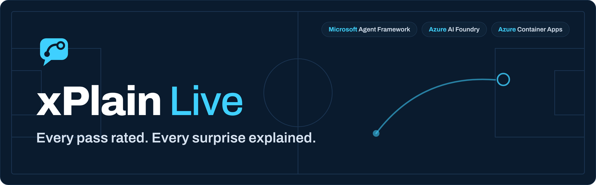
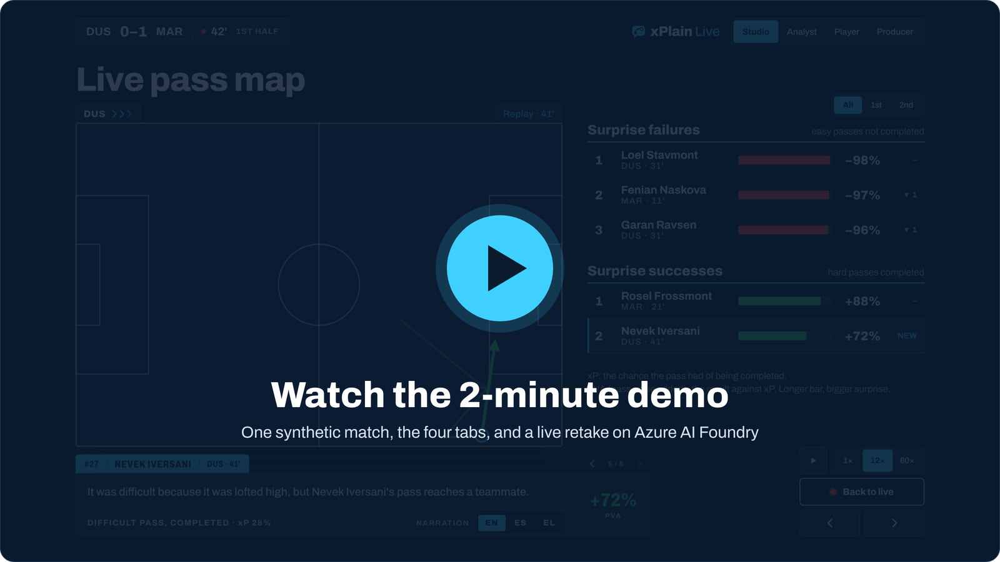
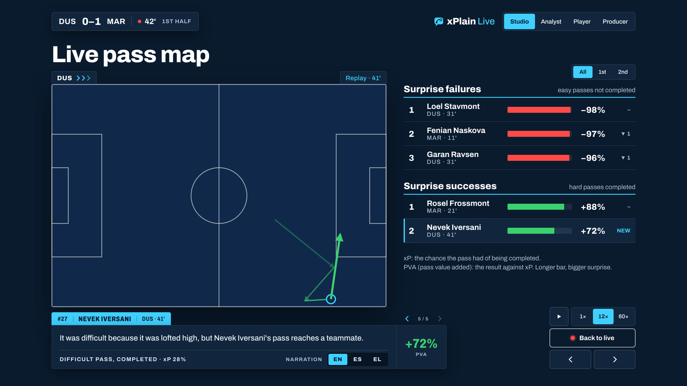
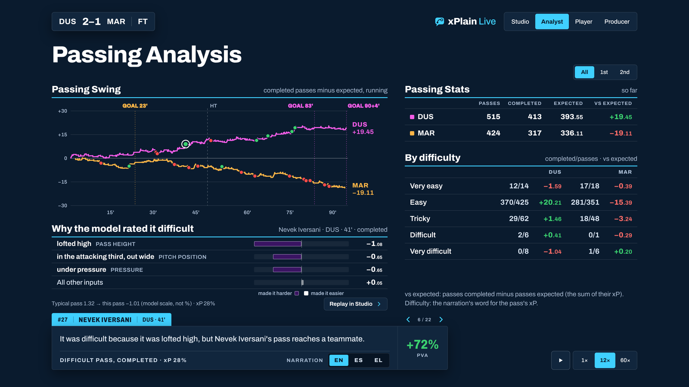
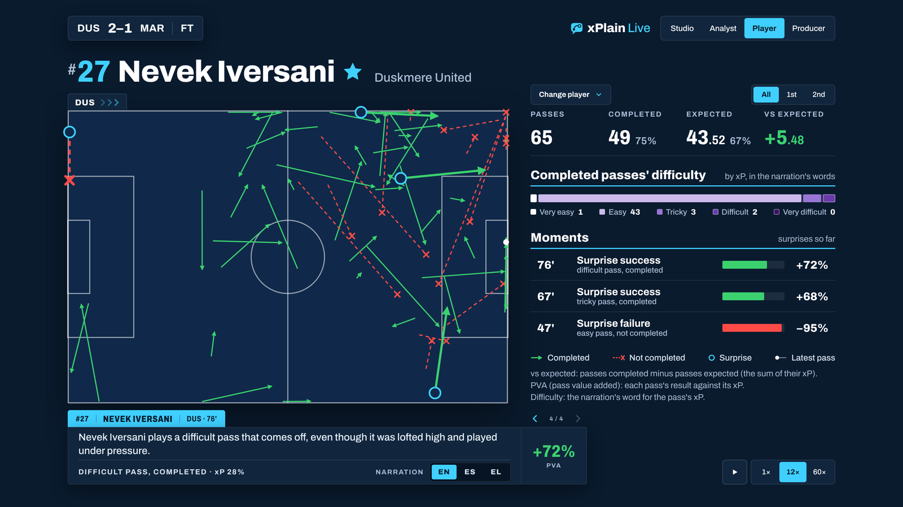
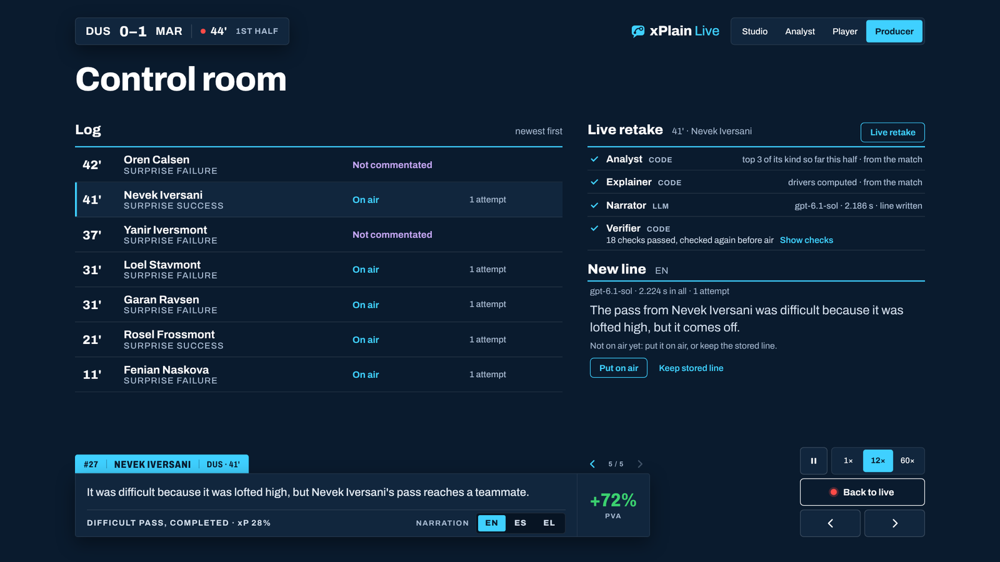
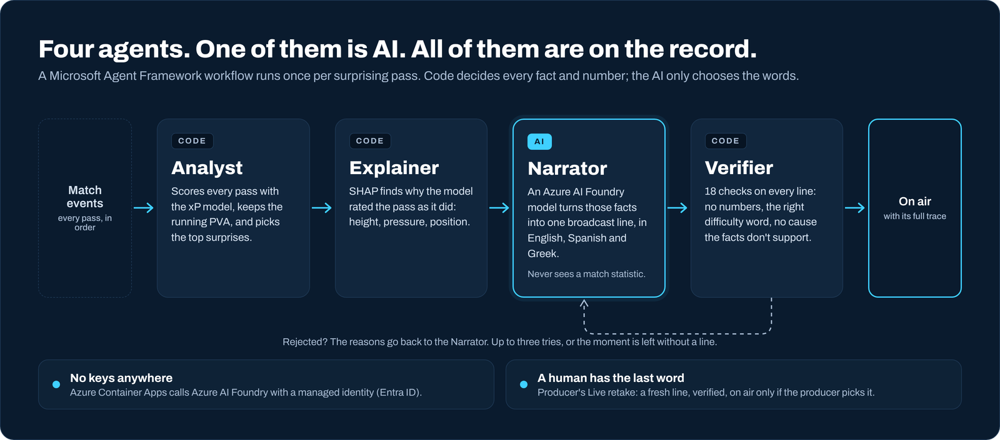
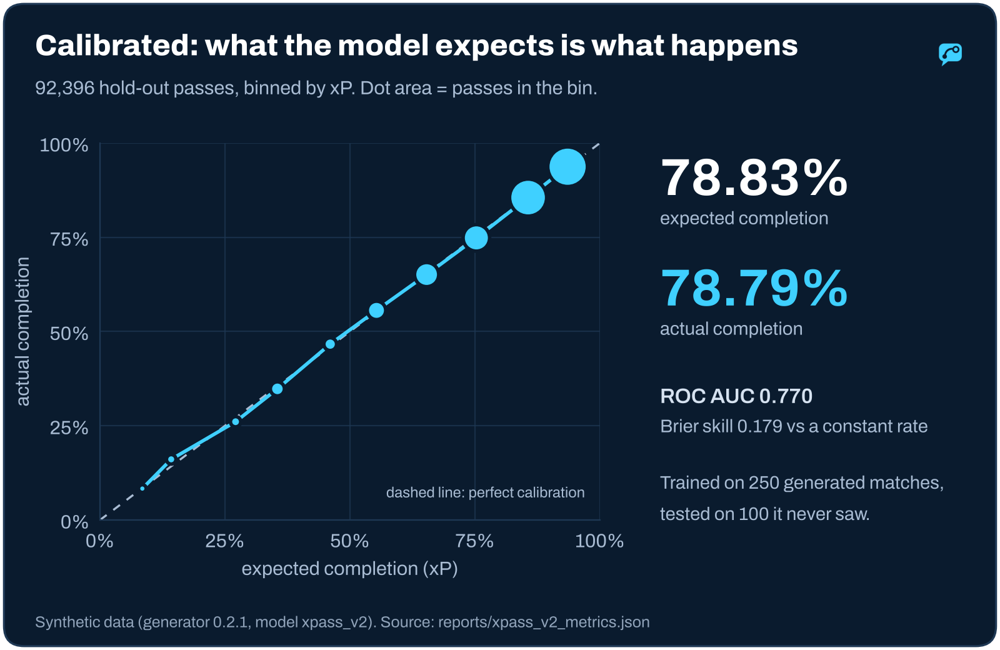
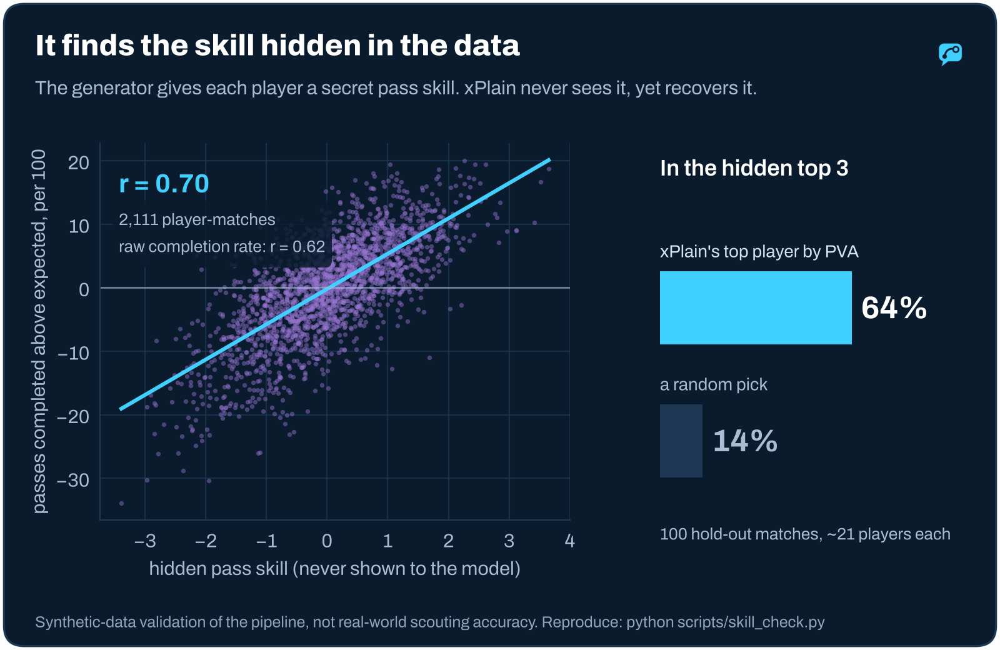
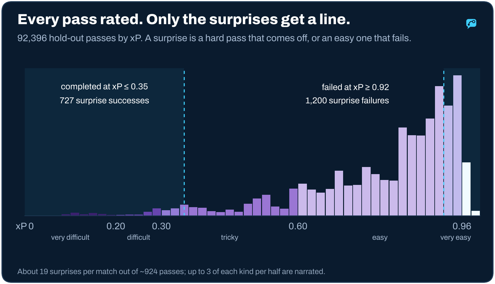

<p align="center">
  
</p>

<p align="center">
  <a href="https://xplain-live.whiteocean-b5bbd7fb.germanywestcentral.azurecontainerapps.io/"><b>▶ Try the live app</b></a>
  &nbsp;·&nbsp;
  <a href="YOUTUBE_LINK"><b>Watch the 2-minute demo</b></a>
  &nbsp;·&nbsp;
  <a href="docs/TECHNICAL.md"><b>Technical reference</b></a>
  <br><br>
  <a href="https://github.com/charalampisandreou/xplain-live/actions/workflows/tests.yml"></a>
  
  
  
</p>

A broadcast can show that a pass was completed. It cannot say whether that was **remarkable**. xPlain Live can.

xPlain Live is a live match-insights engine. A calibrated model rates every pass as it happens, and that one rating
feeds four views of the same match: checked on-air lines and surprise tables for the **broadcast**, Passing Swing and
passing by difficulty for **analysts and coaches**, pass maps and passes completed above expected for each **player**,
and a control room for the **producer**.

When a hard pass comes off, or an easy one fails, four agents explain why the model rated it as it did, in one checked
sentence in English, Spanish or Greek. A Verifier checks every line before air, and a producer always has the last
word.

<p align="center">
  <a href="YOUTUBE_LINK"></a>
</p>

## Try it in 30 seconds

1. Open the **[live app](https://xplain-live.whiteocean-b5bbd7fb.germanywestcentral.azurecontainerapps.io/)**. There is nothing to install and no sign-in.
2. Press **Start match**, then pick **60×**. The match runs fast and slows down by itself just before the first surprise.
3. Read the line on the plate. Click any row in the tables to replay that moment. Open **Analyst** to see *why the model rated it* that way.
4. Open **Producer**, pick a line and press **Live retake**. Azure AI Foundry writes a fresh line and the Verifier checks it live. You decide whether it goes on air.

## One match, four tabs

<table>
  <tr>
    <td width="50%"></td>
    <td width="50%"></td>
  </tr>
  <tr>
    <td><b>Studio.</b> The broadcast view. Minute 41: a difficult pass (xP 28%) comes off, and the plate says why
    the model rated it difficult. Surprise tables rank the match live, with half-time and full-time recaps
    whose numbers are all filled in by code.</td>
    <td><b>Analyst.</b> Passing Swing: each team's completed passes minus expected, minute by minute. Passing by
    difficulty tier, and the model's SHAP reasons for any surprise.</td>
  </tr>
  <tr>
    <td></td>
    <td></td>
  </tr>
  <tr>
    <td><b>Player.</b> Follow any of the 22 players: every pass on the map, passes completed against expected,
    how hard the completed ones were, and their surprising moments, all up to the match clock.</td>
    <td><b>Producer.</b> The control room: every line, the agent steps behind it, the checks the Verifier ran,
    the model and its latency. <b>Live retake</b> asks Foundry for a new line; it airs only if you pick
    <i>Put on air</i>.</td>
  </tr>
</table>

## How it works

<p align="center"></p>

- **Analyst** (code) scores each pass with **xP**, the chance it is completed, judged only from what is known as the
  ball leaves the foot: position, height, body part, pressure and play pattern. **PVA** is the outcome minus xP.
  A pass is a *surprise* when it is completed at xP ≤ 0.35 or fails at xP ≥ 0.92. The Analyst keeps a live top 3 of
  each kind per half.
- **Explainer** (code) runs TreeSHAP on the model to find which inputs pushed the rating up or down. It turns them
  into fixed difficulty words (*very easy* to *very difficult*) and approved phrases.
- **Narrator** (AI, Azure AI Foundry, `gpt-6.1-sol`) turns those facts into one line per language. Code picks one of
  five sentence frames, so the lines do not all sound the same. The Narrator never sees a match statistic and may not
  write a number.
- **Verifier** (code) runs 18 checks on each line. It rejects any digit, a difficulty word that contradicts the
  rating, a cause the facts don't support (it only allows *why the model rated it*, never *why it worked*), and
  banned claims such as "left or right" or intent. A rejected line goes back to the Narrator with the reasons, up to
  three tries.

The four agents run as one **Microsoft Agent Framework** workflow. Every step lands in the trace that Producer shows.
A fifth step, the Recap Editor, writes the half-time and full-time texts the same way.

## Built for production

| | |
|---|---|
| **No keys anywhere** | Azure Container Apps reaches Azure AI Foundry and the container registry with a user-assigned **managed identity** (Entra ID). The image and the template hold no key, token or password. |
| **Every check on record** | Each line keeps its trace: the Analyst's decision, the Explainer's drivers, each Narrator call with model and latency, and every Verifier check. Producer lists them in plain words. |
| **A human decides** | Live retake writes and verifies a new line in seconds. Nothing reaches air until the producer presses *Put on air*. |
| **Safe to fail** | Retakes are rate-limited: one at a time, 10 s apart, 200 a day. Each call has a 20 s timeout. If Foundry is busy, a plain message appears and the stored line stays on air. The broadcast plays a precomputed, verified bundle, so the match never waits on a model. |
| **Cost you can plan** | About **$0.009 per retake** (≈3.5k tokens in, 0.15k out). One replica on 0.5 vCPU keeps the demo warm. |
| **Reproducible** | Seeded synthetic matches. The model is trained in this repository. CI runs **1,000+ tests** on every push and checks the release model and bundle against pinned SHA-256 hashes. |

## The numbers

Every match is **synthetic**: a seeded generator with fictional clubs and players. The model is trained on 250
generated matches and tested on 100 it never saw. These results show that the pipeline works on generated
football. They are not a claim about real-world scouting accuracy.

<p align="center"></p>

**Calibrated.** Across 92,396 hold-out passes the model expected 78.83% to be completed, and 78.79% were. That holds
bin by bin, from hopeful balls to simple passes, which is what makes "surprise" mean something.

<p align="center"></p>

**It finds skill the data hides.** The generator gives every player a secret pass skill that never appears in the
events. Passes completed above expected per pass tracks that skill at **r = 0.70**. Raw completion rate only reaches
0.62, because it mixes skill with difficulty. The match's top player by PVA is in the hidden top 3 in **64%** of
matches, against **14%** by chance. Reproduce it with `python scripts/skill_check.py`.

<p align="center"></p>

**Rated, then filtered.** About 19 of a match's ~924 passes are surprises. Only the strongest (a live top 3 of each
kind per half) are narrated, so the plate stays quiet until there is something worth saying.

## Honest limits

- **Synthetic data only.** No third-party data is used at run time, in training or in the repository. The
  generator's rules are designed, not fitted to real data, so the quality figures check the pipeline, not real
  football.
- **xP is situational difficulty, not pass quality.** It uses start-of-pass information only and does not know the
  intended target, so it never says whether a pass was the right choice.
- **Lines explain the rating, not the outcome.** "Difficult because it was lofted high" is allowed. "It worked
  because…" is not. The cause check is a heuristic and can miss a paraphrase.
- **Languages.** The English and Greek lines were reviewed by native speakers. The Spanish lines were not.
- **The broadcast is precomputed.** The demo plays a bundle whose lines were written on Foundry and verified when it
  was built. Live retake is where the model runs live, on demand.

More detail: [Known simplifications](docs/TECHNICAL.md#known-simplifications) and [Provenance](docs/TECHNICAL.md#provenance).

## Run it yourself

```bash
python3.13 -m venv .venv && source .venv/bin/activate       # Windows: py -3.13 -m venv .venv; .\.venv\Scripts\Activate.ps1
pip install -r requirements-dev.txt

# the trained model and the demo match (git-ignored; the same files CI downloads)
R=https://github.com/charalampisandreou/xplain-live/releases/download/data-v1
mkdir -p models/xpass_v2 data
curl -fsSL -o models/xpass_v2/xpass_v2.joblib   $R/xpass_v2.joblib
curl -fsSL -o models/xpass_v2/feature_list.json $R/feature_list.json
curl -fsSL -o data/bundle_seed3001.json         $R/bundle_seed3001.json

python -m pytest -q                                          # the full suite
python -m uvicorn xplain.api:app --port 8000 --app-dir src   # then open http://127.0.0.1:8000/
```

Serving the demo needs no Azure account. Live retake and building new bundles with narration need Azure AI Foundry
(`az login`). Docker, the one-command Azure deploy and every module are covered in the
[technical reference](docs/TECHNICAL.md).

<details>
<summary><b>What's in the repository</b></summary>

| Path | What it is |
|---|---|
| `src/xplain/generator.py` | Seeded synthetic matches: designed rules, a hidden skill per player |
| `src/xplain/train.py`, `scoring.py` | The xP model (XGBoost, 17 start-of-pass features) and its scoring interface |
| `src/xplain/analytics.py`, `analyst.py`, `pipeline.py` | xP, PVA, surprises and the live top 3 |
| `src/xplain/explainer.py` | TreeSHAP drivers behind each rating |
| `src/xplain/narrator.py`, `verifier.py` | The Narrator agent and the code Verifier |
| `src/xplain/workflow.py` | The Microsoft Agent Framework workflow and its trace |
| `src/xplain/recap*.py` | Half-time and full-time cards, the Recap Editor and its verifier |
| `src/xplain/retake.py`, `api.py` | Live retake and the FastAPI server |
| `src/xplain/web/` | The four tabs: plain HTML, CSS and JS, no build step |
| `infra/main.json`, `scripts/deploy_azure.ps1` | Azure Container Apps (ARM) and the one-command deploy |
| `scripts/skill_check.py` | The hidden-skill check above |

</details>

## Data and licence

Code: MIT (see `LICENSE`). The trained model and the demo bundle are published in the
[data-v1 release](https://github.com/charalampisandreou/xplain-live/releases/tag/data-v1): model files under MIT,
the demo bundle under CC BY 4.0. The bundle's SHA-256 is
`a66b7f2c82467fd03247a1f3d710688921d929e1ad5505eb2a24f1a96282b59f`. All clubs and players are invented.
